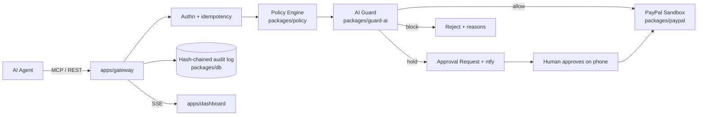

# Tollgate

Tollgate is an open-source firewall for AI agents that move money through PayPal. Agents call Tollgate — over MCP or REST — instead of calling PayPal directly, and every money-moving request passes through a deterministic policy engine plus an AI guard that can only make verdicts stricter, never looser, before it ever reaches PayPal's sandbox.

## Architecture

## Quickstart

_TODO: docker compose up, pnpm demo, PayPal sandbox credentials._

## Demo

_TODO: 2-minute walkthrough script — legit payout, injected invoice blocked, held payout approved from phone, kill switch._

## How AI is used

_TODO: NL→policy compiler, injection scan, intent check — and why the AI can only escalate, never relax, a verdict._

## PayPal APIs used

_TODO: Payouts, Captures Refund, Invoicing v2, Orders v2 — sandbox only._

## Security model

_TODO: trust boundaries, fail-closed rules, hash-chained audit log — see [docs/ARCHITECTURE.md](docs/ARCHITECTURE.md)._

## License

MIT — see [LICENSE](LICENSE).
